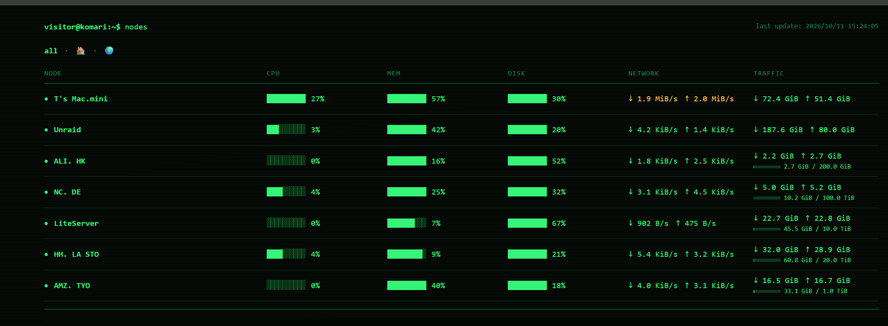

# Btop Minimal for Komari

一个面向个人探针的极简 Komari 主题，以经典命令行监控工具 btop 为视觉参考。



## 特性

- 自适应节点列表：桌面端保持紧凑单行，窄屏自动拆行为节点名、资源、网络和流量。
- 按 Komari 后台 `weight` 保持节点排序，并支持分组筛选。
- 有流量限额的节点显示简洁进度条；使用量超过 80% 以黄色提示。
- 节点详情页合并实时指标与延迟图表，支持 `1h`、`6h`、`24h`、`3d`、`7d`、`30d`。
- 延迟图表为每个监测目标保留稳定的专属颜色，并支持多目标叠加筛选。
- 仅使用主题自身资源，无外部图标或运行时依赖。

## 安装

从 GitHub Releases 下载最新的 `komari-btop-minimal.zip`，在 Komari 管理后台导入主题包。

## 开发

需要 Node.js `22.12.0` 和 npm 10（参见 `.nvmrc` 与 `package.json`）。

```bash
npm ci
npm run dev
npm run check
npm run package
```

`dev` 和 `build` 会自动从 `flag-icons` 生成本地国旗资源；运行时不会请求外部图标服务。`package` 会先执行类型检查和测试，然后生成 `release/komari-btop-minimal.zip`。

主题包根目录包含 `komari-theme.json`、`preview.png` 和 `dist/`。在启用了 Komari 私有站点模式时，查看节点数据需要已认证会话或有效的临时分享会话。

项目采用 [MIT License](./LICENSE)；第三方国旗资源说明见 [THIRD_PARTY_NOTICES.md](./THIRD_PARTY_NOTICES.md)。

---

# Btop Minimal for Komari

A minimal Komari theme for personal monitoring, inspired by the classic command-line monitor btop.


## Features

- An adaptive node table: compact single rows on desktop, with automatic reflow for narrow screens.
- Preserves the Komari backend node order from `weight` and supports group filtering.
- Shows a compact quota progress bar for limited nodes and highlights usage above 80% in yellow.
- Combines live node metrics and latency history on one detail page, with six selectable time ranges.
- Gives each latency probe a stable dedicated color and supports layered multi-probe filtering.
- Uses only theme-local resources; there are no external icons or runtime dependencies.

## Installation

Download the latest `komari-btop-minimal.zip` from GitHub Releases and import it in the Komari administrator panel.

## Development

Node.js 22.12–24.x and npm 10–11 are required (see `.nvmrc` and `package.json`).

```bash
npm ci
npm run dev
npm run check
npm run package
```

`dev` and `build` automatically generate local flag assets from `flag-icons`; the running theme makes no external icon requests. `package` runs type checks and tests before creating `release/komari-btop-minimal.zip`.

The installable package contains `komari-theme.json`, `preview.png`, and `dist/` at its root. A Komari private site requires an authenticated or valid temporary-share browser session to read node data.

This project is available under the [MIT License](./LICENSE). See [THIRD_PARTY_NOTICES.md](./THIRD_PARTY_NOTICES.md) for local flag asset attribution.
